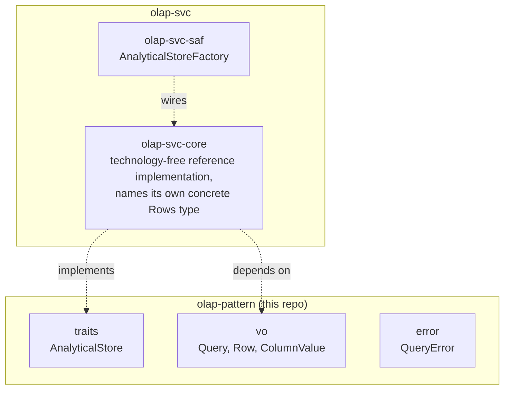

# olap-pattern Architecture

**Audience**: Architects, technical leads, contributors.

## Overview

One crate, `olap-pattern` — this domain's primitives, zero implementation,
zero knowledge of any specific analytical backend:

- **`traits/`** — `AnalyticalStore` (`query(query) -> Self::Rows`,
  `health_check()` — see "Why `Rows` is an associated type, not a boxed
  `RowStream`" below).
- **`vo/`** — `Query` (opaque backend-defined query text), `Row` (ordered
  `(column name, value)` pairs), `ColumnValue` (a small enum of primitives
  common across analytical backends).
- **`error/`** — `QueryError` (`InvalidQuery`, `ExecutionFailed`,
  `ConnectionFailed`).

Everything that would make this crate aware of a specific analytical
technology — a columnar engine, a SQL warehouse, an embedded OLAP
database — lives in
[`olap-svc`](https://github.com/sweengineeringlabs/olap-svc) instead.

## Component Diagram

## Why query text is opaque, not a structured query builder

`Query` wraps a plain `String` with no parsing, no opinion on syntax. A
structured, typed query builder (predicate ASTs, joins, aggregation
clauses) is a materially larger feature — and, critically, it would force
this zero-implementation crate to pick a query model (relational algebra?
a specific DSL?) before any real backend exists to validate that choice
against. Opaque text is the same reasoning `message-broker-pattern::Message`
already applies to payload bytes: carry the backend-defined thing without
having an opinion about its internal shape. Revisit if/when a real backend
in `olap-svc` needs to introspect or rewrite queries rather than pass them
straight through.

## Why ingestion is out of scope for the trait

`AnalyticalStore` has no `insert`/`load`/`ingest` method. Real OLAP
datasets are typically populated by a separate bulk-load pipeline (ETL,
CDC, batch import) — not written record-by-record through the same
surface a caller queries against. Folding ingestion into this trait would
also blur the boundary with `oltp-pattern`'s `TransactionalStore`, whose
entire job is point writes. `olap-svc`'s own in-memory reference
implementation exposes a `seed_table` method for populating test/demo
data — an inherent method on that concrete type, not part of this
contract, since ingestion mechanics are legitimately backend-specific in
a way query execution is not.

## Why `Rows` is an associated type, not a boxed `RowStream`

Raised as a real, checked zero-cost abstraction question in
[olap-pattern#4](https://github.com/sweengineeringlabs/olap-pattern/issues/4):
until v0.2.0, `query` returned `QueryFuture<'_, Result<RowStream, QueryError>>`
— two independent heap allocations per call, one boxing the future itself
(`QueryFuture`), one boxing the returned stream (`RowStream`,
`Pin<Box<dyn Stream<...>>>`), plus a further heap touch on every row polled
out of that boxed stream.

`query`'s own future is fixed the same way every other trait in this
org's zero-cost pass was: `impl Future<Output = ...> + Send + '_`
(RPITIT, stable since 1.75) instead of a boxed wrapper — no allocation,
statically dispatched.

The stream is different, and worth explaining rather than defaulting to
the same fix blindly: `RowStream`'s original erasure bought nothing real.
Every concrete `AnalyticalStore` implementation already knows its own
stream type at compile time — an in-memory backend's `futures::stream::Iter`
over a `Vec`, a networked backend's own client-library cursor type — so
there was never a genuine need to erase it behind `dyn Stream`. `type Rows:
Stream<Item = Result<Row, QueryError>> + Send;` as an associated type lets
each implementation name its own concrete type, and the compiler
monomorphizes `query` per implementation: no allocation, no vtable, for
either the future or the stream it produces. This is different in kind
from `pipeline-pattern`'s `Stage` (a sibling repo's callback type), which
keeps a real, argued box — see that repo's own architecture doc — because
`Stage` genuinely stores heterogeneous closures at runtime; `Rows` doesn't
have that problem, each implementation is exactly one concrete type.

This makes `AnalyticalStore` no longer object-safe (associated type, same
consequence associated types have everywhere else in this org's patterns).
`olap-svc`'s only backend today has no real runtime-backend-selection need,
so its factory returns `impl AnalyticalStore` directly rather than
reaching for a `Box<dyn>`/enum-dispatch workaround — see that repo's own
architecture doc.

## Why no `Validator` trait (yet)

Same reasoning as `scheduler-pattern`'s own architecture doc: there is no
backend config type yet to validate (`olap-svc` starts with `core` only,
which needs no runtime parameters). Adding `Validator` before a real
config type exists to validate would be speculative machinery with
nothing to attach it to.

## Scope boundary

This repo covers exactly `AnalyticalStore` (execute a query, stream back
rows). Not covered:

- **A structured/typed query builder** — see "Why query text is opaque"
  above.
- **Ingestion/bulk-load** — see "Why ingestion is out of scope" above.
- **Schema introspection** (list tables/columns, describe types) — no real
  consumer has needed it yet; adding it later is additive, not breaking.
- **Single-key point CRUD / transactional writes** — already
  `oltp-pattern`'s `TransactionalStore`. `AnalyticalStore` and
  `TransactionalStore` are deliberately two separate `-pattern` crates,
  not one "database-pattern" — different consumers, different evolution
  drivers, even though a single physical database can implement both
  roles.
- **Distributed task queues / pub-sub delivery** — already
  `task-queue-pattern`'s `TaskQueue` / `message-broker-pattern`'s
  `MessageBroker`; neither is a queryable, persistent store.

[← Docs index](../README.md)
